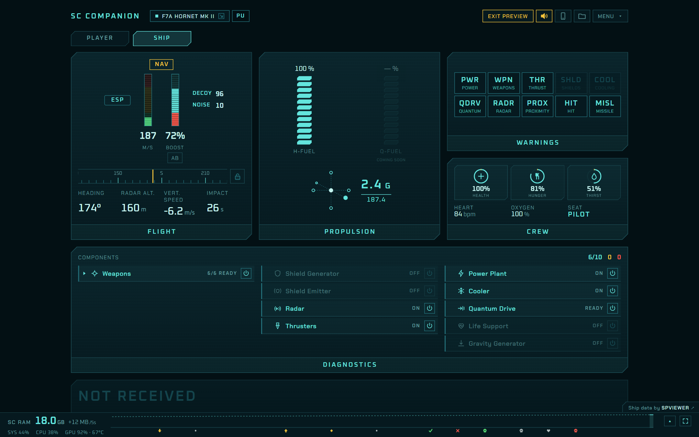
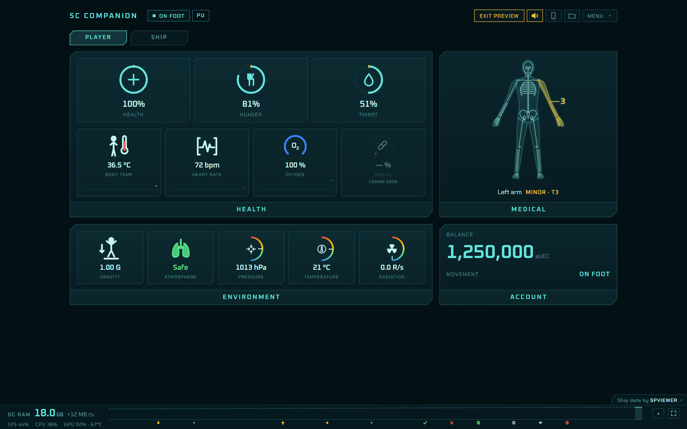
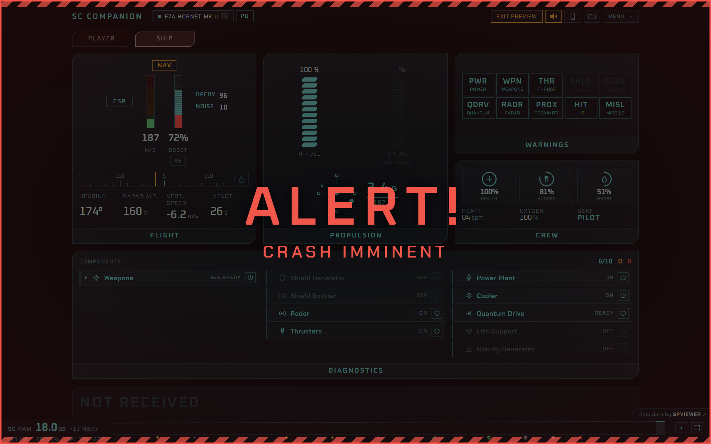

# SC Companion

A lightweight companion screen for Star Citizen, for a second monitor, a tablet or your phone.



| Character screen | Full-screen alert |
| --- | --- |
|  |  |

<sub>Screenshots taken in preview mode (sample data).</sub>

- **Live HUD** from the game's local telemetry: character vitals, ship flight data, warning lights, and full-screen alerts with sound.
- **Memory watch**: Star Citizen's RAM, system memory, CPU and GPU, plus memory-leak detection.
- **Game.log events**: injuries, deaths, kills, contracts, server changes, and a timeline under the RAM chart.
- **Session recording**: each play session is saved with its memory curve and events, so you can review it later.
- **Ship sheets**: speeds, acceleration, fuel and more for any ship.
- **Something to do while it loads**: a small decoupled-flight rock-breaking game plays in the background of the waiting screen. Arrows or WASD to fly, Shift to boost, Space to fire. PC only for now (not on phones and tablets). Add `?rocks` to the address to play it during a game session too.

Read-only. It never touches the game, its files or its memory, and your data stays on your PC.

> **Telemetry and Star Citizen 5.0.** The live HUD needs the game's telemetry stream. It works on LIVE 4.10, but the 5.0 PTU currently doesn't send telemetry. SC Companion detects this and shows *No telemetry* instead of an endless *Loading*. Memory watch, Game.log events, session recording and ship sheets keep working. The HUD will come back on its own if the game turns telemetry on again.

## Install

1. Download `SC-Companion-<version>-win-x64.zip` from the [Releases](https://github.com/Na0f3l/Sc-companion/releases) page.
2. Extract it anywhere, for example to `Documents\SC Companion`. Nothing else is needed: Node.js comes with it.
3. Double-click **`SC Companion.exe`**. The service starts in the background and the companion screen opens in your browser.

An SC Companion icon appears next to the clock. Double-click it to open the screen. Right-click it for Sessions, Mobile connect or **Quit**. For a desktop shortcut, right-click `SC Companion.exe` › *Send to* › *Desktop (create shortcut)*.

**Game telemetry.** The live HUD needs the game's telemetry, which is off by default. If it's off, the companion screen shows an **Enable game telemetry** button. It sets `GRPC_CLIENT_SERVER_ENABLED=true` for your Windows account, no admin rights needed. Then quit the RSI Launcher from its icon next to the clock and start it again. The screen tells you when a restart is still needed.

**First launch warnings.** The download isn't code-signed, so Windows may show *Windows protected your PC*: click *More info* › *Run anyway*. Some antivirus programs may also warn about it. If Windows Firewall asks about Node.js, allow **Private networks**: you only need that to use the screen on your phone.

### On your phone or tablet

Open **Menu › Mobile connect** on the PC and scan the QR code. The phone must be on the same Wi-Fi network. The code holds a private key, so only devices that scanned it can open the screen. The phone remembers it afterwards. *Having issues?* in that window covers firewall and network settings.

### Game folder

SC Companion finds the game on its own. It uses the folder of the running `StarCitizen.exe` (LIVE, PTU, any drive), otherwise the last launch recorded by the RSI Launcher, otherwise the default install folder. To set it yourself, use **Menu › Game folder › Choose…** and pick `StarCitizen.exe` or `Game.log`. **Auto** goes back to detection.

### Your data

Sessions, settings and updated ship data are kept in `%LOCALAPPDATA%\SC Companion`, along with the service log (`service.log`). To uninstall, quit SC Companion from its icon, then delete its folder and that one.

## Development

Requires Node 24 (TypeScript runs natively, no build step for the service).

| Folder | Role |
|---|---|
| `service/` | Node service: reads the game's gRPC telemetry (read-only) or replays a capture, reads Game.log, measures memory / CPU / GPU, records sessions, and serves the interface. Pushes changes to the screens over WebSocket (5 Hz max, only changed values, fully paused when no screen is connected). |
| `interface/` | Vue 3 + Vite + TypeScript + SCSS: HUD-style screens (flight, character), full-screen alerts with sound. |
| `scripts/` | `release.mjs`: builds the portable zip. |
| `launcher/` | `Launcher.cs`: source of `SC Companion.exe`. |
| `telemetrie/` | Tools: probe, fake server, raw capture of unknown fields. |
| `memoire/` | Standalone PowerShell memory / CPU / GPU tracker with leak detection (not in the release). |

```
cd interface && npm install && npm run build   # after every interface change
cd service   && npm install && node src/index.ts  # then open http://localhost:2950
```

The release script also puts a copy of `SC Companion.exe` at the repository root (ignored by Git). There it starts the service with the installed Node, since there's no bundled `node\node.exe`. Launcher options: `--port <n>`, `--no-browser`; any other arguments go to the service. `Lancer.vbs` does the same, but VBScript is being removed from Windows. `npm run dev` in `interface/` is only for development: in normal use the service serves the built interface itself (Vite would cost ~500 MB).

Service options: `--game-dir <folder>` (forces the game folder), `--port <n>`, `--replay ../telemetrie/captures` (replays captures), `--no-tray`. Start it with `node` directly rather than `npm run`, because npm keeps a ~60 MB parent process alive.

**Release:** set the version in `interface/package.json`, then run `node scripts/release.mjs`. It produces `release/SC-Companion-<version>-win-x64.zip`. The zip contains the launcher `SC Companion.exe` (`launcher/Launcher.cs`, compiled with the C# compiler that ships with Windows), the official Node.js for the current version (checksum verified) with its license, the service with production dependencies only, the built interface, README and LICENSE.

**Telemetry schema:** not included and not downloaded. The service extracts it from the installed game (`Bin64\StarCitizen.exe` embeds its protobuf descriptors), once per game version, and caches it in `%LOCALAPPDATA%\SC Companion`, so it always matches the installed version. As a fallback, it uses `telemetrie/proto/sc_telemetry.proto` if present (for example from the community project [Sokren/sc-telemetry-deck](https://github.com/Sokren/sc-telemetry-deck)), only when the executable can't be read.

**Mobile access:** the PC always has access. Other devices need the key from the Mobile connect QR code (`?k=…`), which is then kept in a cookie (`service/src/access.ts`). It's deliberately light protection: the service can't control the game and knows no credentials.

Measured footprint: ~59 MB private memory, ~1 % of one CPU core, ~0.3 KB/s per screen.

### What the game sends (LIVE 4.10)

**Received:** health, hunger, thirst, temperature, heart rate, O₂, environment, balance, speed, H-fuel, boost, G (total), radar altitude, heading, vertical speed, warning lights, landing gear, IFCS, power, weapons, countermeasures.

**In the schema but never sent:** Q-fuel, hull, shields, flight mode, events, force feedback. No motion vectors either, so there's no reverse, drift or per-axis G. After a game update, you can check this with `npm run raw` in `telemetrie/`.

## Credits

Alert sounds (`interface/public/sounds/`):

- red alert: "warning" by **Lyubomir Ikonomov** ([Freesound 787777](https://freesound.org/s/787777/)), free to use;
- amber alert: "Mechanical gas release alert" ([Mixkit](https://mixkit.co/)).

Ship data (`interface/public/data/`, regenerated with `npm run ships` in `service/`; when the wiki announces a new game version, the interface's "Update ship data" button refreshes it without a rebuild):

- names, speeds, rotation, fuel: [Star Citizen Wiki API](https://api.star-citizen.wiki);
- acceleration in G measured in game: community data from [SPViewer](https://www.spviewer.eu).

## License

SC Companion is free and open source, under the MIT License (see `LICENSE`). Third-party material (sounds, fonts, ship data, telemetry schema, bundled Node.js) keeps its own license: see Credits above and the About window in the app.

Unofficial fan project, not affiliated with or endorsed by Cloud Imperium Games. Star Citizen®, Roberts Space Industries® and Cloud Imperium® are trademarks of Cloud Imperium Rights LLC.
